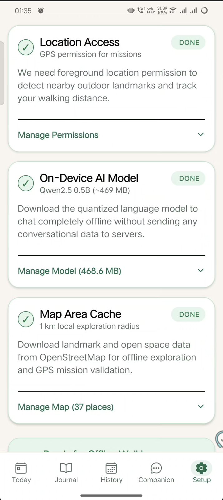
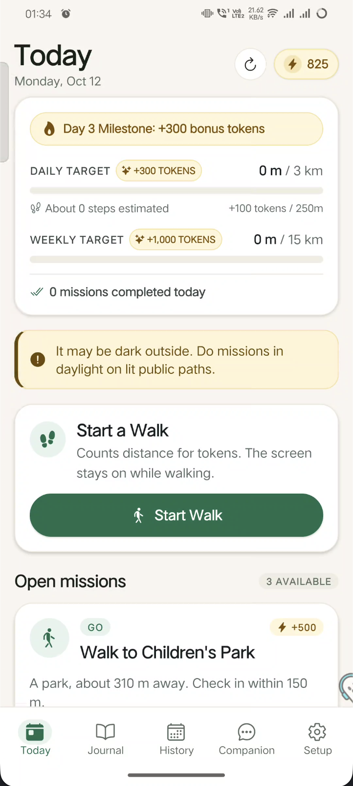
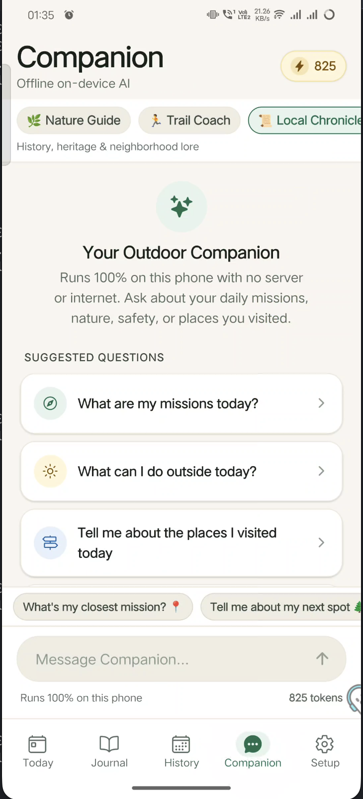
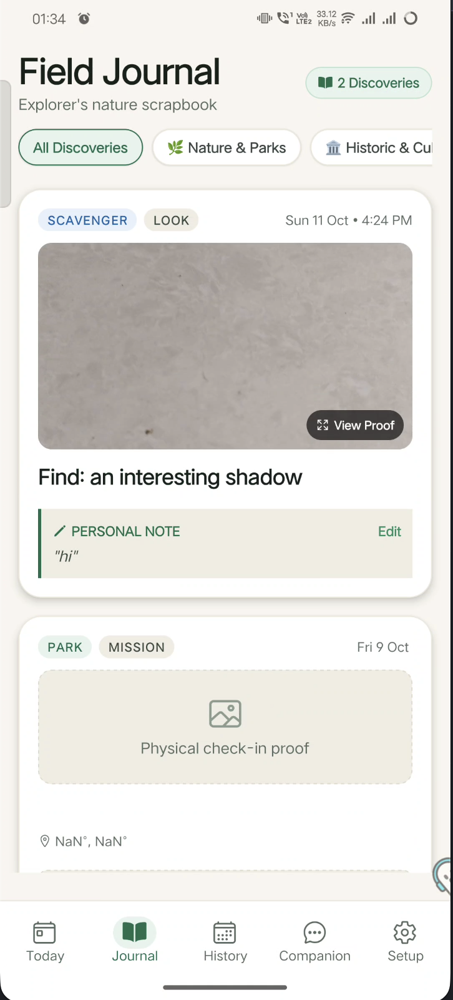
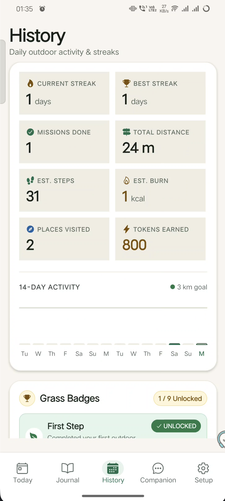

# 🌱 Touch Grass

> **Stop doomscrolling. Touch actual grass. Earn free on-device AI tokens.**  
> A 100% offline, privacy-first mobile exploration game that trades physical footsteps for local AI compute.

---

## 📸 Screenshots & Visual Tour

Here is what **Touch Grass** looks like in action:

| 1. Setup & Model Download | 2. Daily Quests (`Today`) | 3. Offline AI (`Companion`) | 4. Field Journal | 5. Stats & Badges (`History`) |
|:---:|:---:|:---:|:---:|:---:|
|  |  |  |  |  |
| *One-time Wi-Fi model grab & OSM area cache* | *GO / LOOK / LEARN daily quest cards* | *Private Qwen 0.5B LLM — 1 token per token* | *Scrapbook with geotags & proof photos* | *14-day activity chart & 9 Grass Badges* |

---

## 💡 Why This Exists

### The Problem
- **The Laptop Trap:** Developers, engineers, and students are glued to screens 12+ hours a day. Zero sunlight, zero movement, pure burnout.
- **The \$20/month AI Tax:** ChatGPT Plus, Claude Pro, and cloud API tokens are expensive. If you are a broke student or indie developer, you get locked out or hit with monthly subscription fatigue.
- **The Privacy Dilemma:** Most fitness and lifestyle apps track your GPS 24/7 and beam your photos and private logs straight to remote ad servers.

### The Fix: "Proof of Touch Grass"
**What if your physical exercise literally paid for your AI compute?**

1. **Close the laptop & step outside.**
2. **Walk 250 meters** → ⚡ **Earn 100 tokens**.
3. **Complete daily nature & heritage quests** → 🌿 **Earn up to 700 bonus tokens**.
4. **Spend your earned tokens chatting with a local AI Companion** powered by an on-device Large Language Model (`Qwen2.5-0.5B-Instruct` via `llama.rn`).

**Zero subscription fees. Zero API keys. Zero cloud telemetry. Zero tracking.**  
Just your real-world steps powering an offline intelligence in your pocket.

---

## 🎮 The Game Loop

```
  ┌──────────────────────────────────────────────────────────────┐
  │ 💻 Dev glued to laptop: 0 tokens, burned out                 │
  └──────────────────────────────┬───────────────────────────────┘
                                 │
                                 ▼  [Step Outside & Walk]
  ┌──────────────────────────────────────────────────────────────┐
  │ 🚶 Walk 250m (+100 Tokens) & Complete Daily Missions:        │
  │    • GO: Walk to local park/green space (+500 Tokens)        │
  │    • LOOK: Photograph an outdoor scavenger item (+300 Tokens)│
  │    • LEARN: Discover historic landmark/monument (+700 Tokens)│
  └──────────────────────────────┬───────────────────────────────┘
                                 │
                                 ▼  [Proof Verified On-Device]
  ┌──────────────────────────────────────────────────────────────┐
  │ 🛡️ Anti-Cheat Validation: Real GPS (<25m accuracy, <4.2 m/s) │
  │    + EXIF camera photo proof saved to Field Journal          │
  └──────────────────────────────┬───────────────────────────────┘
                                 │
                                 ▼  [Spend Earned Tokens]
  ┌──────────────────────────────────────────────────────────────┐
  │ 🤖 Offline On-Device AI Companion:                           │
  │    Qwen2.5-0.5B runs locally on device CPU/GPU via llama.rn  │
  │    Burns 1 earned token per LLM token generated              │
  └──────────────────────────────────────────────────────────────┘
```

---

## ✨ Core Features

- **🔋 100% Offline-First (Airplane Mode Ready):**
  Uses internet exactly **once** during setup to download the quantized GGUF model weights (~469 MB) and cache a 1 km radius of OpenStreetMap data. After that, the app functions entirely offline in parks, forests, and off-grid trails.
- **🤖 Grounded Local AI (`llama.rn`):**
  Runs `Qwen2.5-0.5B-Instruct-GGUF` directly on your smartphone processor. AI responses are strictly grounded in OpenStreetMap tags from landmarks you physically visited, eliminating hallucinations.
- **🎯 3 Daily Mission Archetypes:**
  - **`GO`**: Walk to a designated green space (park, garden, woodland) and check in inside a strict 60m geofence.
  - **`LOOK`**: Scavenger hunt prompt (e.g. textured bark, wild flower, natural stone) verified via camera capture.
  - **`LEARN`**: Check in at a local monument, heritage site, or historic tree to learn real neighborhood lore.
- **🛡️ Anti-Cheat Sensory Validation:**
  Built-in filters discard mock GPS locations, reject drift (>25m accuracy required), and block vehicular cheating (>4.2 m/s / 15.1 km/h threshold).
- **📔 Field Journal & Scrapbook:**
  Automatically logs your completed discoveries with photo proofs, timestamps, and notes.
- **🏆 9 Unlockable Grass Badges:**
  Earn accolades like *First Step*, *5K Wanderer*, *25K Explorer*, *Century Club*, *Local Historian*, and *Golden Hour Explorer*.

---

## 🪙 Token Economy Breakdown

| Activity | Reward | Description |
|---|:---:|---|
| **Walking** | `+100 tokens` | Awarded every 250 meters of valid walking distance |
| **`GO` Mission** | `+500 tokens` | Reach and check in at a designated green space |
| **`LOOK` Mission** | `+300 tokens` | Capture and verify a nature scavenger item |
| **`LEARN` Mission** | `+700 tokens` | Check in at a local heritage site or historic tree |
| **AI Generation** | `-1 token` | Deducted for every token produced by the local LLM |

---

## 🛠️ Tech Stack

| Technology | Version | Role in Project |
|---|---|---|
| **React Native** | `0.86.3` | Cross-platform mobile runtime with New Architecture enabled |
| **React** | `19.2.3` | Modern declarative UI component library |
| **Expo SDK** | `~57.0.27` | Native build toolchain & device runtime management |
| **Expo Router** | `^57.0.25` | File-based navigation & tab routing (`app/(tabs)`) |
| **llama.rn** | `^0.13.0-rc.7` | C++ bindings for `llama.cpp` on-device mobile inference |
| **Qwen2.5-0.5B-Instruct** | `q4_k_m` (~469 MB) | Quantized GGUF model powering private offline companion |
| **OpenStreetMap** | Overpass API | Open geospatial data for parks, monuments, and nature spots |
| **Zustand** | `^5.0.15` | Lightweight state store with migration versioning (`v5`) |
| **expo-location** | `^57.0.20` | Real-time GPS tracking and geofence distance calculation |
| **expo-image-picker** | `^57.0.20` | Native camera capture with EXIF extraction |

---

## 🚀 Quickstart & Setup Guide

### Prerequisites
- **Node.js**: `18.x` or `20.x` LTS
- **Package Manager**: `npm` (included with Node)
- **Mobile Development Environment**:
  - **Android**: Android Studio with SDK 34+, NDK `26.1.10909125`, and CMake 3.22.1+.
  - **iOS**: macOS with Xcode 15+ and CocoaPods.

### 1. Clone & Enter Project Directory
```bash
git clone https://github.com/neoquantx/Touch_Grass.git
cd Touch_Grass
```

### 2. Install Dependencies
```bash
npm install
```

### 3. Run Automated Verification Tests
Verify all geospatial formulas, progress migrations, mission generators, and AI grounding logic:
```bash
npm test
```
*Expected output: All 8 test suites pass (`PASS: All mission checks passed`, `ALL check_badges.js tests PASSED!`, etc.).*

### 4. Launch on Device / Emulator

> [!NOTE]
> Because `llama.rn` compiles native C++ `llama.cpp` code, you must run a **native development build** (standard Expo Go does not contain custom C++ binaries).

#### Android
```bash
npx expo run:android
```

#### iOS (macOS required)
```bash
npx expo run:ios
```

---

## 📱 In-App First-Run Setup (30 Seconds)

When you launch the app for the first time:
1. Open the **Setup** tab (`setup.png`).
2. **Grant Permissions:** Allow GPS Location and Camera.
3. **Download Model:** Tap **Download Model** to fetch the ~469 MB quantized Qwen 0.5B GGUF weights (one-time download over Wi-Fi).
4. **Cache Area:** Tap **Cache Area** to prefetch a 1,000m radius of local OpenStreetMap landmarks.
5. You are done! Turn on Airplane Mode, lace up your sneakers, and start earning tokens.

---

## 📂 Project Directory Structure

```text
touch-grass/
├── app/                      # Expo Router screens
│   ├── _layout.js            # App wrapper, fonts, and dark theme
│   └── (tabs)/               # Bottom tab navigation
│       ├── _layout.js        # Tab bar configuration
│       ├── index.js          # Today: active missions & live walk tracker
│       ├── journal.js        # Journal: field scrapbook & photo proof
│       ├── history.js        # History: 14-day chart, stats & badges
│       ├── companion.js      # Companion: offline on-device AI chat
│       └── setup.js          # Setup: permissions, model & map cache
├── src/                      # Core business logic
│   ├── components/           # Reusable UI cards, headers, modal toasts
│   ├── constants/            # Badge definitions, archetypes & config
│   ├── hooks/                # useGps, useStepCounter, useMissionProgress
│   ├── services/             # llama.rn client, OSM Overpass fetcher, anti-cheat
│   ├── store/                # Zustand stores (useProgressStore, useSettingsStore)
│   └── utils/                # Haversine distance, bearings, dates & EXIF
├── docs/                     # Documentation assets
│   └── screenshots/          # The 5 visual screenshots (PNG)
├── scripts/                  # Automated verification tests (run via npm test)
└── package.json              # Dependencies & run scripts
```

---

## 🔧 Troubleshooting

| Issue | Cause | Fix |
|---|---|---|
| **`llama.rn` build failure on Android** | Missing or mismatched Android NDK / CMake | Open Android Studio SDK Manager → SDK Tools. Install NDK `26.1.10909125` and CMake `3.22.1`. |
| **Model download fails midway** | Unstable network or storage permission | Ensure at least 1 GB of free device storage and a stable Wi-Fi connection. The app supports resume on retry. |
| **"GPS accuracy poor" warning** | Testing indoors where satellite fix is weak | Move near a window or outdoors. Anti-cheat requires `< 25m` GPS horizontal accuracy to prevent spoofing. |
| **Offline map has 0 landmarks** | Remote rural area with sparse OSM coverage | The app automatically generates fallback procedural nature checkpoints so you never get stuck without missions. |

---

## 🤝 Contributing & License

Contributions, bug reports, and PRs are welcome!
- Run `npm test` before committing to ensure all 8 test suites pass.
- Open a PR describing your changes.

Distributed under the [MIT License](LICENSE). Built for Hacktoberfest. Grab your phone, step outside, and touch grass! 🌱
